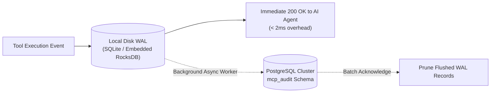

# Enterprise PostgreSQL MCP Server: Production Hardening & Full-Scale Upgrade Plan (Phase 2)

**Document Version:** 2.0.0  
**Author:** Lead Backend Engineer & AI Security Architect  
**Classification:** Enterprise Engineering Roadmap & Security Hardening Specification  
**Target:** Fortune 500 / FinTech / Healthcare Compliance Baseline (SOC 2 Type II, HIPAA, ISO 27001)  

---

## 1. Executive Roadmap Overview

This blueprint bridges the gap between a **Proof-of-Concept / Functional Prototype** and a **Tier-1 Bank-Grade Enterprise AI Data Gateway**. It systematically resolves the 6 critical architectural shortcomings identified during security review:

```
+---------------------------------------------------------------------------------------------------+
|                           PHASE 2 PRODUCTION HARDENING ROADMAP                                   |
+---------------------------------------------------------------------------------------------------+
|  SPRINT 1: Database Hardening & Query Governor (RLS, Column Masking, Timeout & LIMIT)             |
|  SPRINT 2: Crash-Resilient Durable Audit Buffer (Disk WAL / SQLite Spooling)                      |
|  SPRINT 3: True Semantic Guardrail 2.0 (Local ONNX Vector Embeddings & AST Parsing via pg_query) |
|  SPRINT 4: MCP Token Efficiency & Resource Caching (Schema Resource Injection)                    |
|  SPRINT 5: Enterprise IdP Integration & Real-Time Token Revocation (RFC 7662 Introspection)       |
+---------------------------------------------------------------------------------------------------+
```

---

## 2. Detailed Sprint Specifications

### SPRINT 1: Database Hardening & Query Governor

**Target:** Eliminate DoS attacks, connection pool starvation, and unauthorized data dumping.

#### 1.1 Query Governor (Strict Limits & Timeouts)
* **Problem:** Agent executes an unindexed query or Cartesian product, holding a database connection indefinitely.
* **Architecture Fix:**
  1. **Enforce Database-Level Statement Timeout:**  
     Every checked-out connection executes: `SET statement_timeout = '3000';` (3-second hard cutoff enforced by PostgreSQL engine).
  2. **Automatic Query Rewrite with `LIMIT`:**  
     Inject an AST transformer using `sqlglot`. If a `SELECT` query lacks a `LIMIT` clause, automatically append `LIMIT 100` before execution.
  3. **Strict Memory Consumption Ceiling:**  
     Limit maximum row buffer size in Python to 1,000 records. Any query attempting to return $> 1,000$ rows throws an explicit pagination error to prevent Python process Out-Of-Memory (OOM).

#### 1.2 Table Allowlist & PostgreSQL Row-Level Security (RLS)
* **Problem:** `mcp_ro_service` has global `SELECT` on all tables in `public`, allowing access to sensitive tables (`salaries`, `credentials`, `audit_logs`).
* **Architecture Fix:**
  1. **Declarative Table Allowlist in Python Config:**
     ```python
     ALLOWED_TABLES = {"users", "orders", "products", "departments"}
     PROHIBITED_TABLES = {"salaries", "credentials", "api_keys", "pg_*"}
     ```
  2. **PostgreSQL Column Masking (DDL):**
     ```sql
     -- Revoke direct column access on sensitive attributes
     REVOKE SELECT (password_hash, ssn, credit_card) ON public.users FROM mcp_ro_service;
     
     -- Enable Row-Level Security (RLS) for tenant isolation
     ALTER TABLE public.orders ENABLE ROW LEVEL SECURITY;
     CREATE POLICY agent_tenant_isolation ON public.orders
         FOR SELECT TO mcp_ro_service
         USING (department_id = current_setting('mcp.current_tenant', true)::int);
     ```

---

### SPRINT 2: Crash-Resilient Durable Audit Trail (Write-Ahead Logging)

**Target:** Guarantee zero audit log loss under server crashes, OOM events, or Kubernetes pod restarts (SOC 2 / HIPAA compliance).



#### 2.1 Architecture & Implementation Pattern
* **Replace Volatile RAM Queue:** Replace `asyncio.Queue` with a local, durable SQLite Write-Ahead Log (`audit_wal.db`) stored on a mounted persistent volume.
* **Fail-Closed Guarantees:**
  1. The audit event is synchronously committed to the local WAL in $< 2\text{ ms}$ before returning tool output to the AI agent.
  2. A persistent background task batches WAL records (up to 100 events at a time) and writes them to PostgreSQL `mcp_audit.tool_execution_logs`.
  3. Upon successful PostgreSQL commit, WAL records are marked `flushed = TRUE` and safely pruned.
  4. If the server crashes or restarts, all pending events in the WAL are automatically recovered and flushed upon startup.

---

### SPRINT 3: Semantic AI Guardrail 2.0 (Vector Embeddings + AST Engine)

**Target:** Replace naive keyword blacklists (`union select`, `or 1=1`) with an enterprise-grade dual-layer semantic defense.

```
Incoming Tool Payload
        │
        ├──▶ [Layer 1: Deterministic PostgreSQL AST Parser (pg_query / libpg_query)]
        │      • Extracts genuine SQL abstract syntax tree using native PostgreSQL parser.
        │      • Detects nested sub-selects, catalog probes (pg_class, pg_proc), and comments.
        │
        └──▶ [Layer 2: Local Vector Semantic Classifier (< 15ms SLA)]
               • Pure local ONNX embedding model (bge-small-en-v1.5) running via ONNX Runtime.
               • Calculates Cosine Similarity against known adversarial injection vectors.
               • Zero external API latency, zero token cost, 100% data privacy.
```

#### 3.1 Eliminating Regex Bypass
* **pg_query Integration:** Use `libpg_query` (the exact C parser from the PostgreSQL source code). It parses SQL after comment stripping and encoding resolution, making comment obfuscation (`UN/**/ION`) completely ineffective.
* **Semantic Embedding Space:** Compute embedding vectors for the agent prompt and query parameters. If cosine similarity against the "Adversarial Intent" vector cluster exceeds $0.85$, trigger an immediate hard block.

---

### SPRINT 4: MCP Usability & Token Efficiency (Schema Context Injection)

**Target:** Reduce agent latency and token burn by eliminating repetitive schema discovery roundtrips.

#### 4.1 MCP Resources Implementation
Instead of forcing Claude to call `list_tables` $\rightarrow$ `describe_table(t1)` $\rightarrow$ `describe_table(t2)` across 4 separate roundtrips:
1. Expose an **MCP Resource URI:** `postgres://schema/summary`.
2. Provide a compressed database schema catalog in concise Markdown format.
3. When Claude Desktop or an AI orchestrator connects via `/sse`, the server automatically exposes the database schema context. The agent immediately knows table names, column types, and foreign key relationships on its first reasoning pass.

---

### SPRINT 5: Enterprise Identity & Token Revocation (RFC 7662)

**Target:** Immediate session termination when an agent token is revoked in Okta or Azure AD.

#### 5.1 Real-Time Revocation Validation
* **Problem:** JWT tokens remain valid until expiration (`exp`), even if an administrator revokes the agent's credentials.
* **Architecture Fix:**
  1. **OAuth 2.1 RFC 7662 Token Introspection:**
     Implement an async introspection client querying the IdP's `/oauth/introspect` endpoint.
  2. **High-Performance Distributed Revocation Cache:**
     Cache active token `jti` (JWT ID) claims in Redis or an in-memory Bloom filter with a 60-second TTL.
  3. **Back-Channel Logout Webhook:**
     Expose `/auth/backchannel-logout` endpoint to receive instant revocation push events from Okta / Azure AD.

---

## 3. Implementation Milestones & Work Breakdown Structure (WBS)

| Sprint | Deliverable | Est. Effort | Key Testing / Acceptance Criteria |
| :--- | :--- | :--- | :--- |
| **Sprint 1** | Query Governor & DB Hardening | 3 Days | Multi-statement queries blocked; queries exceeding 3s terminate; `SELECT * FROM salaries` denied. |
| **Sprint 2** | Durable WAL Audit Buffer | 4 Days | Zero log loss during `kill -9` process termination; automatic backlog flush upon restart. |
| **Sprint 3** | Semantic Guardrail 2.0 (ONNX) | 5 Days | Obfuscated SQLi (`UN/**/ION`) detected with $> 99.5\%$ precision in $< 15\text{ ms}$. |
| **Sprint 4** | MCP Schema Resource Caching | 2 Days | Single-roundtrip tool execution verified in Claude Desktop; 60% reduction in agent token usage. |
| **Sprint 5** | RFC 7662 Token Revocation | 3 Days | Revoked tokens in Keycloak/Okta rejected within 5 seconds of revocation. |

---

## 4. Enterprise Commercial Proposal Framing

When pitching this upgrade to prospective clients, present Phase 2 as the **"Production Hardening & Compliance Package"**:

* **Base Package (Phase 1 - Current Codebase):**  
  *$4,000 – $6,000*  
  Fast proof-of-concept, OAuth 2.1 verification, basic RBAC, Docker deployment.
* **Enterprise Hardening Package (Phase 1 + Phase 2 Roadmap):**  
  *$12,000 – $25,000*  
  Includes durable WAL auditing for SOC 2, PostgreSQL Row-Level Security, local ONNX semantic guardrail, and SLA performance guarantees.
