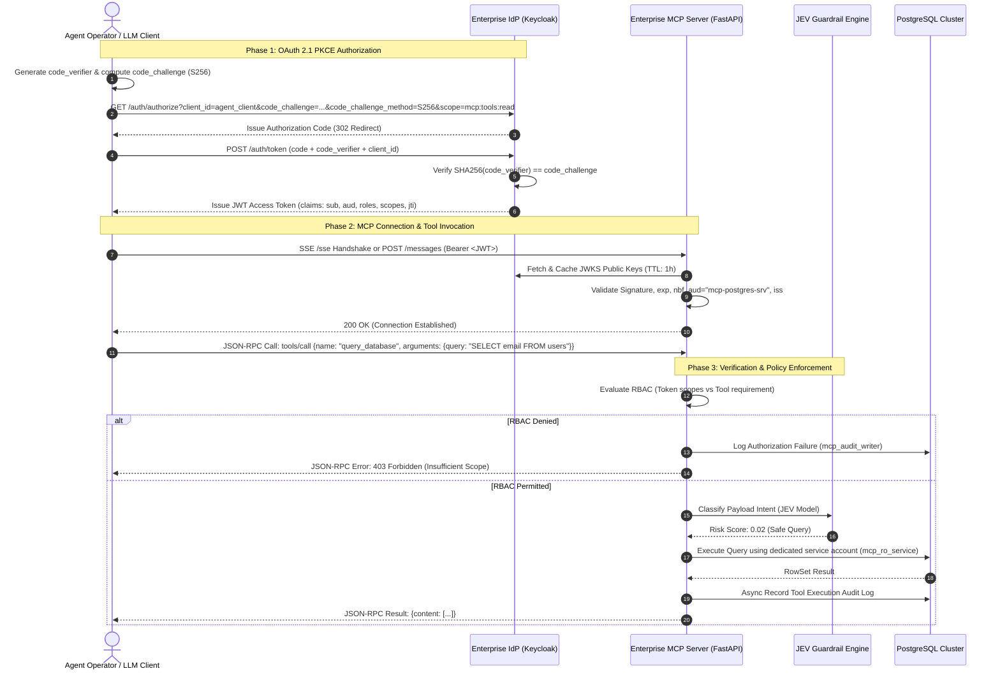
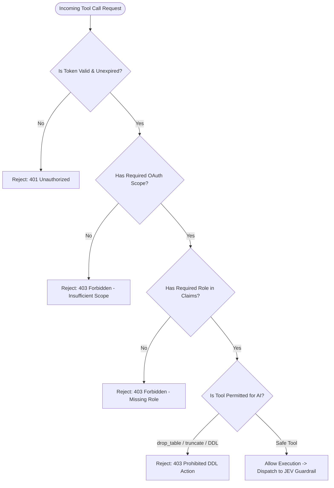

# Enterprise PostgreSQL MCP Server: Solution Architecture Document

**Document Version:** 1.0.0  
**Status:** Approved / Architecture Baseline  
**Classification:** Enterprise Technical Specification  
**Target Platform:** Model Context Protocol (MCP) | FastAPI | PostgreSQL 16+  

---

## 1. Executive Summary & Problem Space

Enterprise deployment of Large Language Models (LLMs) such as Anthropic Claude 3.5 Sonnet requires robust, deterministic, and auditable integration patterns when connecting to critical relational data stores. The Model Context Protocol (MCP) open standard exposes database interfaces as standardized tools over JSON-RPC transports (stdio and Server-Sent Events / SSE).

However, bridging an untrusted AI agent to an internal relational database introduces severe threat vectors:
1. **The Confused Deputy Attack:** An agent operating on behalf of a low-privilege user or external prompt injecting queries to access unauthorized data.
2. **Token Passthrough Hazards:** Propagating end-user or agent authorization tokens directly to the database layer compromises connection pooling, breaks least-privilege boundaries, and leaks credential context across trust boundaries.
3. **Unbounded Privilege Escalation:** Agents dynamically constructing SQL strings that bypass business logic and authorization barriers.
4. **Lack of Forensic Auditability:** Inability to correlate an agent's reasoning chain or tool call to an identifiable identity and exact executed SQL statement.

This architecture specifies an **Enterprise PostgreSQL MCP Server** engineered as an authenticating and authorizing Policy Enforcement Point (PEP) and Policy Decision Point (PDP). The server implements **OAuth 2.1 with PKCE**, strictly enforces **No Token Passthrough**, provides **Tool-Level Role-Based Access Control (RBAC)**, and records an immutable, structured **Audit Trail** for every tool call and authorization event.

---

## 2. High-Level Architecture Topology

```
 +-------------------------------------------------------------------------------+
 |                            TRUST BOUNDARY: CLIENT                             |
 |                                                                               |
 |   +------------------------------------+                                      |
 |   |        AI Orchestration Host       |                                      |
 |   |     (e.g., Claude 3.5 Desktop,     |                                      |
 |   |    LangGraph, Custom Agent Host)   |                                      |
 |   +------------------+-----------------+                                      |
 +----------------------|--------------------------------------------------------+
                        |
                        | (1) Authorization Code + PKCE
                        v
 +-------------------------------------------------------------------------------+
 |                     TRUST BOUNDARY: IDENTITY PROVIDER                         |
 |                                                                               |
 |   +-----------------------------------------------------------------------+   |
 |   |               Enterprise IdP (Keycloak / Okta / Auth0)                |   |
 |   |  - Issues OAuth 2.1 RFC 9068 Cryptographic JWTs                       |   |
 |   |  - Signs with RS256/ES256 via OIDC JWKS Endpoint                      |   |
 |   +-----------------------------------+-----------------------------------+   |
 +---------------------------------------|---------------------------------------+
                                         |
                                         | (2) Bearer Access Token (Scoped)
                                         v
 +-------------------------------------------------------------------------------+
 |                       TRUST BOUNDARY: MCP SERVICE MESH                        |
 |                                                                               |
 |   +-----------------------------------------------------------------------+   |
 |   |            Enterprise PostgreSQL MCP Server (FastAPI)                 |   |
 |   |                                                                       |   |
 |   |  +-------------------------+      +--------------------------------+  |   |
 |   |  |   Transport Layer       |      |    OAuth 2.1 / PKCE Auth       |  |   |
 |   |  |   (MCP SSE & JSON-RPC)  | ---> |    Security Interceptor        |  |   |
 |   |  +-------------------------+      +---------------+----------------+  |   |
 |   |                                                   |                   |   |
 |   |                                                   v                   |   |
 |   |  +-------------------------+      +--------------------------------+  |   |
 |   |  |   Audit Logging Engine  | <--- |   Tool-Level RBAC Engine       |  |   |
 |   |  |  (Async Queue / Buffer) |      |   (Policy Enforcement Point)   |  |   |
 |   |  +------------+------------+      +---------------+----------------+  |   |
 |   |               |                                   |                   |   |
 |   |               |                                   v                   |   |
 |   |               |                   +--------------------------------+  |   |
 |   |               |                   |  AI Guardrail (JEV Classifier) |  |   |
 |   |               |                   +---------------+----------------+  |   |
 |   |               |                                   | (Approved Only)   |   |
 |   |               |                                   v                   |   |
 |   |               |                   +--------------------------------+  |   |
 |   |               |                   |  Parameterized Query Engine    |  |   |
 |   |               |                   +---------------+----------------+  |   |
 |   +---------------|-----------------------------------|-------------------+   |
 +-------------------|-----------------------------------|-----------------------+
                     |                                   |
                     | (4) Write Audit Logs              | (3) Service Account
                     |     (Dedicated Audit Pool)        |     Connection Pool
                     v                                   v
 +-------------------------------------------------------------------------------+
 |                       TRUST BOUNDARY: DATA PERSISTENCE                        |
 |                                                                               |
 |   +-----------------------------------------------------------------------+   |
 |   |                      PostgreSQL 16 Enterprise Cluster                 |   |
 |   |                                                                       |   |
 |   |   [Audit Logs & Security Events]     [Business Tables (App Data)]     |   |
 |   |   Owner: `mcp_audit_writer`          Owner: `app_schema_owner`        |   |
 |   |   (Append-Only Permissions)          Grants: `mcp_ro_service` (SELECT)|   |
 |   |                                              `mcp_rw_service` (DML)   |   |
 |   +-----------------------------------------------------------------------+   |
 +-------------------------------------------------------------------------------+
```

---

## 3. OAuth 2.1 with PKCE Authentication Flow

OAuth 2.1 consolidates modern OAuth 2.0 best practices (RFC 6749, RFC 7636, RFC 8252, and the OAuth 2.0 Security Best Current Practice). Specifically:
* **PKCE (Proof Key for Code Exchange) is mandatory** for all authorization code flows, eliminating authorization code interception attacks on public clients.
* **Implicit grant (`response_type=token`) and Resource Owner Password Credentials (ROPC) are removed**.
* **Redirect URIs must be exact-match strings**.
* **Bearer tokens must be cryptographically verifiable** via JSON Web Key Sets (JWKS) and bound to a specific audience (`aud`).

### 3.1 Authentication & Tool Execution Sequence



### 3.2 Token Claims Specification

The MCP Server validates access tokens against the RFC 9068 (JWT Profile for OAuth 2.0 Access Tokens) standard:

```json
{
  "iss": "https://auth.enterprise.internal/realms/ai-services",
  "sub": "agent-claude-3-5-sonnet-prod-01",
  "aud": "mcp-postgres-server",
  "client_id": "ai-orchestrator-gateway",
  "exp": 1728144000,
  "nbf": 1728140400,
  "iat": 1728140400,
  "jti": "8f9d0c2e-4b71-482a-9411-9a7e8f5223e1",
  "scope": "openid mcp:tools:read mcp:tools:schema",
  "realm_access": {
    "roles": [
      "mcp_analyst_readonly",
      "data_classification_tier2"
    ]
  },
  "agent_metadata": {
    "operator_email": "data-eng-lead@enterprise.com",
    "delegation_depth": 1,
    "environment": "production"
  }
}
```

---

## 4. The "No Token Passthrough" Principle & Confused Deputy Mitigation

### 4.1 The Confused Deputy Attack in AI Agent Architectures

In a classical confused deputy attack, an intermediary entity (the deputy) with elevated access is tricked by an unauthorized client into exercising its authority on the client's behalf. 

In AI-driven database architectures, token passthrough—wherein an agent passes its user authentication token directly downstream to PostgreSQL (via OAuth-to-Kerberos exchange or custom DB extensions)—introduces critical security failures:

```
[Attacker Prompt] 
       | (Malicious Prompt Injection)
       v
[LLM Agent] 
       | (Subverted Agent passes User Token directly to DB)
       v
[PostgreSQL Database] ---> Executes malicious query using the Agent's identity!
```

### 4.2 Why Token Passthrough is Prohibited

| Dimension | Token Passthrough (Flawed) | No Token Passthrough (This Architecture) |
| :--- | :--- | :--- |
| **Authentication Boundary** | Identity leaks directly across trust zones into database engine. | Clear perimeter: Token is terminated at the MCP layer; DB is isolated. |
| **Connection Pooling** | Breaks connection pooling completely. Each token requires an independent authenticated connection, leading to pool starvation under load. | Highly efficient pooling via `asyncpg` with dedicated static service credentials. |
| **Least Privilege Enforcement** | Relies on database-native grants which lack LLM-specific context (rate limiting, tool parameters, prompt intent). | Dual-layer security: MCP server validates tool-level RBAC and semantic intent before touching DB. |
| **Auditability** | DB logs only show generic identity or opaque OAuth session without tool parameters or LLM context. | Full contextual audit: Links agent identity, tool arguments, intent risk score, and generated SQL. |
| **Credential Blast Radius** | Compromising an agent session grants direct, ambient network access to the PostgreSQL instance. | Agent has zero network access or credentials to the database; it can only invoke declared MCP tools. |

### 4.3 Policy Enforcement Point (PEP) Isolation Pattern

The Enterprise MCP server operates strictly as an intermediary gatekeeper:
1. **Terminate & Validate:** The incoming JWT is cryptographically verified against the enterprise IdP JWKS.
2. **Context Derivation:** Extract identity attributes (`sub`, `client_id`, `roles`, `scope`).
3. **Policy Decision:** Validate whether the caller possesses the exact permission required for the requested tool.
4. **Internal Credential Elevation:** The server checks out a pre-allocated connection from an internal connection pool authenticated as a dedicated, low-privilege service account:
   - `mcp_ro_service`: Read-only queries (`SELECT` only, strict timeout, schema-restricted).
   - `mcp_rw_service`: Data manipulation queries (`INSERT`, `UPDATE` within specific schemas).
   - `mcp_admin_service`: Strictly disabled for automated LLM agents.
5. **Session Isolation:** At no point do client credentials, user tokens, or untrusted session identifiers reach the database socket.

---

## 5. Tool-Level Role-Based Access Control (RBAC)

The MCP server implements fine-grained, declarative RBAC mapped directly to MCP tool definitions. Every tool call must satisfy both **Scope Requirements** (OAuth 2.1 protocol level) and **Role Requirements** (Application domain level).

### 5.1 Tool Permission Matrix

| MCP Tool Name | Description | Required OAuth Scope | Required Role | DB Service Account Used |
| :--- | :--- | :--- | :--- | :--- |
| `list_tables` | Lists accessible schemas and tables | `mcp:tools:schema` | `mcp_viewer` | `mcp_ro_service` |
| `describe_table` | Retrieves column types, keys, and indexes | `mcp:tools:schema` | `mcp_viewer` | `mcp_ro_service` |
| `read_query` | Executes parameterized `SELECT` queries | `mcp:tools:read` | `mcp_analyst_readonly` | `mcp_ro_service` |
| `execute_report` | Executes pre-approved analytical views | `mcp:tools:read` | `mcp_analyst_readonly` | `mcp_ro_service` |
| `update_record` | Updates targeted rows with explicit primary keys | `mcp:tools:write` | `mcp_operator_write` | `mcp_rw_service` |
| `bulk_insert` | Performs controlled batch imports | `mcp:tools:write` | `mcp_operator_write` | `mcp_rw_service` |
| `drop_table` | DDL drop command (**Prohibited for LLMs**) | `mcp:admin` | `mcp_dba_admin` | Denied by Policy Engine |

### 5.2 RBAC Policy Decision Logic



---

## 6. Comprehensive Audit Logging Architecture & Database Schema

Every interaction with the MCP server—whether an authentication attempt, an RBAC failure, or a completed SQL execution—is captured in an append-only audit subsystem.

### 6.1 Audit Design Principles
1. **Asynchronous Non-Blocking Emission:** Audit logs are pushed to an in-memory `asyncio.Queue` and processed by a dedicated worker pool, guaranteeing zero latency degradation on tool responses.
2. **Fail-Closed Security:** If the audit subsystem fails or the audit database is unreachable, the server rejects incoming write operations to prevent un-audited state changes.
3. **Payload Sanitization & PII Masking:** Input arguments are sanitized before storage (credit card numbers, passwords, emails masked or hashed via SHA-256).
4. **Partitioning & Retention:** Audit tables are range-partitioned by timestamp (monthly) to support high-throughput ingestion and automated cold-storage archival.

### 6.2 Relational Audit Schema (DDL)

```sql
-- ============================================================================
-- Enterprise MCP Server Audit Subsystem Schema
-- PostgreSQL 16+ Standard DDL
-- ============================================================================

CREATE SCHEMA IF NOT EXISTS mcp_audit;

-- Extension for cryptographic UUID generation
CREATE EXTENSION IF NOT EXISTS "pgcrypto";

-- ----------------------------------------------------------------------------
-- 1. Enum Types for Audit Categorization
-- ----------------------------------------------------------------------------
CREATE TYPE mcp_audit.execution_status AS ENUM (
    'SUCCESS',
    'AUTHENTICATION_FAILED',
    'AUTHORIZATION_DENIED',
    'GUARDRAIL_BLOCKED',
    'VALIDATION_ERROR',
    'EXECUTION_ERROR',
    'TIMEOUT'
);

CREATE TYPE mcp_audit.actor_type AS ENUM (
    'AUTONOMOUS_AGENT',
    'HUMAN_IN_THE_LOOP',
    'SCHEDULED_ORCHESTRATOR'
);

-- ----------------------------------------------------------------------------
-- 2. Master Audit Table: Range Partitioned by Timestamp
-- ----------------------------------------------------------------------------
CREATE TABLE mcp_audit.tool_execution_logs (
    event_id UUID DEFAULT gen_random_uuid(),
    event_timestamp TIMESTAMPTZ NOT NULL DEFAULT clock_timestamp(),
    
    -- Actor Context
    actor_id VARCHAR(255) NOT NULL,              -- Token 'sub'
    client_id VARCHAR(255) NOT NULL,             -- Token 'client_id'
    actor_type mcp_audit.actor_type NOT NULL DEFAULT 'AUTONOMOUS_AGENT',
    operator_reference VARCHAR(255),             -- Delegated human email/id
    session_id VARCHAR(255) NOT NULL,            -- MCP connection / session trace
    
    -- Request Vector
    client_ip INET NOT NULL,
    user_agent TEXT,
    tool_name VARCHAR(128) NOT NULL,
    
    -- Security Claims & Authorization
    granted_scopes TEXT[] NOT NULL,
    granted_roles TEXT[] NOT NULL,
    required_scope VARCHAR(128) NOT NULL,
    required_role VARCHAR(128) NOT NULL,
    
    -- Payloads & Cryptographic Integrity
    input_payload_hash CHAR(64) NOT NULL,        -- SHA-256 of raw arguments
    sanitized_arguments JSONB NOT NULL,          -- Sanitized arguments
    
    -- Guardrail Scoring (JEV Evaluation)
    guardrail_evaluated BOOLEAN NOT NULL DEFAULT FALSE,
    guardrail_risk_score NUMERIC(5, 4),          -- 0.0000 to 1.0000
    guardrail_decision VARCHAR(64),              -- e.g., 'PERMITTED', 'BLOCKED'
    guardrail_reason TEXT,
    
    -- Execution Details
    execution_status mcp_audit.execution_status NOT NULL,
    db_service_account VARCHAR(64) NOT NULL,     -- e.g., 'mcp_ro_service'
    sql_statement_fingerprint TEXT,              -- Parameterized SQL template
    rows_returned INTEGER DEFAULT 0,
    rows_affected INTEGER DEFAULT 0,
    duration_ms NUMERIC(10, 3) NOT NULL,
    error_code VARCHAR(32),
    error_message TEXT,
    
    PRIMARY KEY (event_timestamp, event_id)
) PARTITION BY RANGE (event_timestamp);

-- ----------------------------------------------------------------------------
-- 3. Monthly Partitions (Example Initial Partition Set)
-- ----------------------------------------------------------------------------
CREATE TABLE mcp_audit.tool_execution_logs_2026_10 PARTITION OF mcp_audit.tool_execution_logs
    FOR VALUES FROM ('2026-10-01 00:00:00+00') TO ('2026-11-01 00:00:00+00');

CREATE TABLE mcp_audit.tool_execution_logs_2026_11 PARTITION OF mcp_audit.tool_execution_logs
    FOR VALUES FROM ('2026-11-01 00:00:00+00') TO ('2026-12-01 00:00:00+00');

-- ----------------------------------------------------------------------------
-- 4. High-Performance Indexing Strategy
-- ----------------------------------------------------------------------------
CREATE INDEX idx_audit_event_id ON mcp_audit.tool_execution_logs (event_id);
CREATE INDEX idx_audit_actor_timestamp ON mcp_audit.tool_execution_logs (actor_id, event_timestamp DESC);
CREATE INDEX idx_audit_tool_status ON mcp_audit.tool_execution_logs (tool_name, execution_status);
CREATE INDEX idx_audit_status_timestamp ON mcp_audit.tool_execution_logs (execution_status, event_timestamp DESC);
CREATE INDEX idx_audit_payload_gin ON mcp_audit.tool_execution_logs USING GIN (sanitized_arguments);

-- ----------------------------------------------------------------------------
-- 5. Dedicated Security Authorization Failure Log Table
-- ----------------------------------------------------------------------------
CREATE TABLE mcp_audit.authorization_failures (
    failure_id UUID PRIMARY KEY DEFAULT gen_random_uuid(),
    failure_timestamp TIMESTAMPTZ NOT NULL DEFAULT clock_timestamp(),
    client_ip INET NOT NULL,
    raw_token_jti VARCHAR(255),
    claimed_sub VARCHAR(255),
    attempted_tool VARCHAR(128) NOT NULL,
    denial_reason TEXT NOT NULL,
    raw_headers JSONB
);

CREATE INDEX idx_auth_failures_timestamp ON mcp_audit.authorization_failures (failure_timestamp DESC);

-- ----------------------------------------------------------------------------
-- 6. Role & Permission Grants (Principle of Least Privilege)
-- ----------------------------------------------------------------------------
-- Dedicated writer account used exclusively by MCP Server Audit Worker
CREATE ROLE mcp_audit_writer WITH LOGIN PASSWORD 'REPLACE_IN_PRODUCTION_SECRETS';
GRANT USAGE ON SCHEMA mcp_audit TO mcp_audit_writer;
GRANT INSERT ON mcp_audit.tool_execution_logs TO mcp_audit_writer;
GRANT INSERT ON mcp_audit.authorization_failures TO mcp_audit_writer;

-- Strictly deny UPDATE, DELETE, and TRUNCATE to enforce append-only audit trail
REVOKE UPDATE, DELETE, TRUNCATE ON ALL TABLES IN SCHEMA mcp_audit FROM mcp_audit_writer;
```

---

## 7. Zero-Trust Defense-in-Depth Summary

```
                      INCOMING AGENT REQUEST
                                 |
                                 v
        [Layer 1: Network Ingress & Mutual TLS / TLS 1.3]
                                 |
                                 v
        [Layer 2: OAuth 2.1 RFC 9068 Verification + PKCE]
                                 |
                                 v
        [Layer 3: Tool-Level Scope & Role Enforcement (RBAC)]
                                 |
                                 v
        [Layer 4: Real-Time AI Intent Guardrail (JEV Model)]
                                 |
                                 v
        [Layer 5: Parameterized Query Construction & Sanitization]
                                 |
                                 v
        [Layer 6: Isolated Service Account Execution (asyncpg)]
                                 |
                                 v
        [Layer 7: Tamper-Evident Append-Only PostgreSQL Audit]
```

This multi-layer architecture guarantees that compromised or hallucinating agents cannot execute arbitrary data corruption or exfiltration, providing enterprise security teams with forensic traceability and deterministic control.
